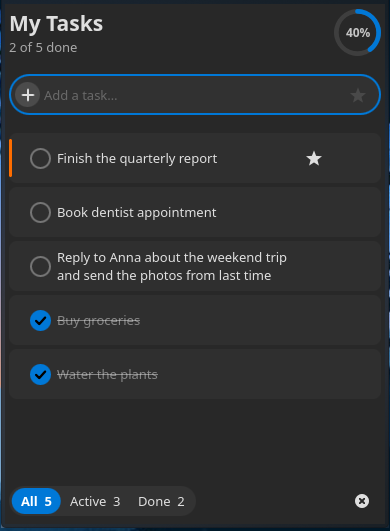

# Crisp Todo

A clean, friendly todo list widget for KDE Plasma 5.



## Features

- Type a task and press **Enter** to add it. Click the star to add it as important.
- Round, animated checkboxes. Finished tasks fade out and move to the bottom.
- Hover a task to drag it into a new position, star it, or delete it.
- Due dates: pick a date from the calendar or choose Today, Tomorrow or Next week. Overdue tasks turn red, and the **Today** tab lists everything due today or overdue.
- Double-click a task to edit it (**Enter** saves, **Esc** cancels).
- Undo after deleting a task or clearing completed ones.
- **All / Today / Active / Done** filters with counts, and a progress ring in the header.
- The panel icon shows how many tasks are left.
- Uses your Plasma theme colours, so it works in light and dark mode.

## Requirements

KDE Plasma 5 (tested on 5.24). Plasma 6 is not supported yet.

## Install

```sh
git clone git@github.com:ROF13ThFloor/Crisp-Todo-KDE-Widget.git
cd Crisp-Todo-KDE-Widget
./install.sh
```

Then right-click your panel or desktop, choose **Add Widgets**, and search for **Crisp Todo**.

Run `./install.sh` again to update. To reload a widget that is already placed, restart Plasma:

```sh
plasmashell --replace & disown
```

To uninstall:

```sh
kpackagetool5 -t Plasma/Applet -r com.github.rof13thfloor.crisptodo
```

## Development

Preview the widget in its own window:

```sh
plasmawindowed com.github.rof13thfloor.crisptodo
```

For a resizable test window, install `plasma-sdk` and run `plasmoidviewer -a com.github.rof13thfloor.crisptodo`.

| File | Purpose |
| --- | --- |
| `crisp-todo/contents/ui/main.qml` | Task data and actions (add, edit, delete, undo, reorder, save) |
| `crisp-todo/contents/ui/FullRepresentation.qml` | Popup layout: header, input, list, filters |
| `crisp-todo/contents/ui/TodoDelegate.qml` | A single task row |
| `crisp-todo/contents/ui/CompactRepresentation.qml` | Panel icon with the remaining-tasks badge |
| `crisp-todo/contents/config/` | Settings schema and settings page |

## Releases

Releases are made automatically. When a milestone named like `v1.1` is closed on GitHub, the
[Release workflow](.github/workflows/release.yml) sets the version in `metadata.json`, builds
`crisp-todo-v1.1.plasmoid` and publishes a release with the closed issues as release notes.
It stops if the milestone still has open issues.

To install a release, download the `.plasmoid` file and run:

```sh
kpackagetool5 -t Plasma/Applet -i crisp-todo-v1.1.plasmoid
```

## Where tasks are stored

Tasks are saved as JSON in the widget's Plasma config, in `~/.config/plasma-org.kde.plasma.desktop-appletsrc` under the `todos` key. Each widget instance keeps its own list. Removing the widget also removes its tasks.

## License

GPL-2.0-or-later. See [LICENSE](LICENSE).
